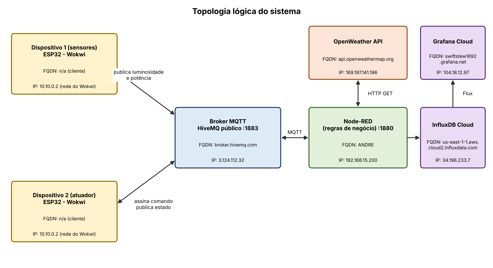
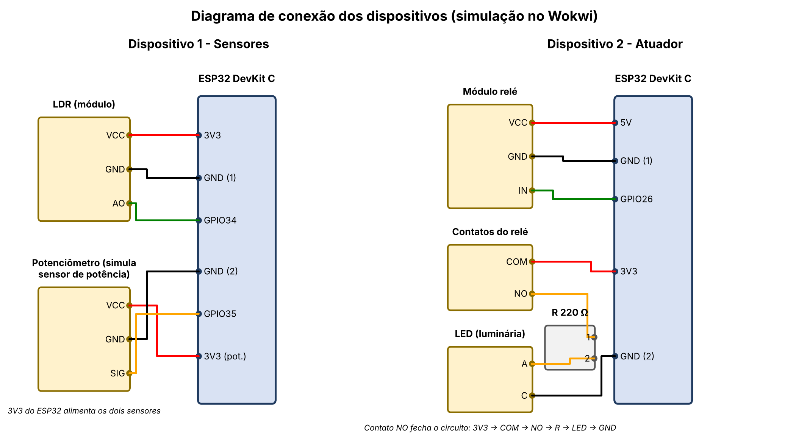

# Sistema de Automação de Iluminação por Luminosidade Ambiente para Eficiência Energética Predial

Projeto da disciplina **Objetos Inteligentes Conectados** (Universidade Presbiteriana Mackenzie).

- **Integrantes:** [Nome 1], [Nome 2], [Nome 3]
- **ODS:** 7 – Energia Limpa e Acessível | **Meta 7.3** (eficiência energética)
- **Vídeo de apresentação:** [COLE AQUI O LINK DO YOUTUBE]
- **Dispositivo 1 (sensor) no Wokwi:** https://wokwi.com/projects/481422055951067137
- **Dispositivo 2 (atuador) no Wokwi:** https://wokwi.com/projects/481422034321038337
- **Artigo:** [docs/artigo.pdf](docs/artigo.pdf)

## 1. Descrição

Um dispositivo mede a luminosidade do ambiente (LDR) e a potência da luminária (potenciômetro, que simula um sensor de potência).
Um segundo dispositivo aciona a luminária por um relé. O Node-RED recebe as leituras por MQTT, aplica as regras de negócio
(histerese de luminosidade e ajuste do limiar pela cobertura de nuvens da API OpenWeather), envia comandos ao atuador
e grava tudo no InfluxDB Cloud. O Grafana exibe dois dashboards, incluindo a economia de
energia entre o **cenário A** (sem automação) e o **cenário B** (com automação).

## 2. Arquitetura




| Elemento | Onde roda |
|---|---|
| Dispositivo 1 (sensores) e 2 (atuador) | Wokwi (ESP32 simulado) |
| Broker MQTT | HiveMQ público (`broker.hivemq.com:1883`) |
| Node-RED | Máquina local do grupo |
| Banco de dados | InfluxDB Cloud |
| Dashboards | Grafana Cloud |

Cada elemento fica em servidor/serviço distinto.

## 3. Tópicos MQTT

Prefixo exclusivo do grupo: `iot/ilumq7x/ods7` (troque nos 3 lugares descritos na seção 5).

| Tópico | Publicador | Assinante | Conteúdo |
|---|---|---|---|
| `iot/ilumq7x/ods7/luminosidade` | Dispositivo 1 | Node-RED | `{"luminosidade": 123.4, "bruto": 2100, "dispositivo": "dev1_sensor"}` |
| `iot/ilumq7x/ods7/potencia` | Dispositivo 1 | Node-RED | `{"potencia_W": 40.0, "bruto": 2730, "dispositivo": "dev1_sensor"}` |
| `iot/ilumq7x/ods7/comando` | Node-RED | Dispositivo 2 | `LIGAR` ou `DESLIGAR` (retido, QoS 1) |
| `iot/ilumq7x/ods7/estado` | Dispositivo 2 | Node-RED | `LIGADO` ou `DESLIGADO` (retido) |

## 4. Regras de negócio

1. **Histerese:** luminosidade < limiar de acionamento (150 lux) → `LIGAR`; > limiar de desligamento (200 lux) → `DESLIGAR`.
   Mudança confirmada por 2 amostras consecutivas; o comando só é enviado quando o estado muda.
2. **Clima:** se `clouds.all` (OpenWeather) > 70 %, os dois limiares sobem 50 lux.
3. **Energia:** potência efetiva = potência medida (cenário A) ou potência medida só com a luminária ligada (cenário B);
   a energia é a integral da potência efetiva no tempo (`E = Σ Pi·Δt`).

Leituras fora da faixa válida (lux < 0 ou > 100000) são descartadas.

## 5. Como reproduzir

### 5.1 Pré-requisitos (contas gratuitas)
Wokwi, InfluxDB Cloud, Grafana Cloud, OpenWeather (chave de API), Node.js 18+ e Node-RED.

### 5.2 Prefixo dos tópicos
Substitua `iot/ilumq7x/ods7` pelo prefixo do seu grupo em: `dispositivo1_sensor/sketch.ino`, `dispositivo2_atuador/sketch.ino`
e `node-red/flows.json` (busca e substituição em todo o arquivo).

### 5.3 Dispositivos no Wokwi
1. Crie um projeto **ESP32** em wokwi.com para cada dispositivo.
2. Cole `sketch.ino`, `diagram.json` e `libraries.txt` da pasta correspondente.
3. Inicie a simulação e confirme `Conectando ao broker MQTT... OK` no monitor serial.

### 5.4 Node-RED
1. Instale a paleta `node-red-contrib-influxdb` (lista de nós em `node-red/nos_instalados.md`).
2. Defina a variável de ambiente (modelo em `.env.example`): `OPENWEATHER_KEY`.
3. Inicie o Node-RED e importe `node-red/flows.json` (Menu > Import).
4. Edite o nó de configuração **InfluxDB Cloud** (URL e token) e o nó `grava iluminacao_ods7` (organização e bucket).
5. Faça o **Deploy**.

### 5.5 InfluxDB Cloud
Crie o bucket `iluminacao` e um token com permissão de escrita (Node-RED) e outro de leitura (Grafana).
Estrutura do bucket: `influxdb/estrutura_bucket.md`. Consultas: `influxdb/queries.flux`. Dados gravados na medição `iluminacao_ods7`:

| Campo | Descrição |
|---|---|
| `luminosidade` | lux |
| `potencia_medida_W` | potência do sensor (W) |
| `potencia_efetiva_W` | potência considerada no cálculo de energia (W) |
| `estado_cmd` / `estado_real` | comando enviado / estado confirmado (0 ou 1) |
| `limiar_on` / `limiar_off` | limiares vigentes (lux) |
| `nuvens_pct` | cobertura de nuvens (%) |

Tag: `cenario` (`A` ou `B`).

### 5.6 Grafana
Adicione o data source InfluxDB (linguagem Flux) e crie os dois dashboards com as consultas de `influxdb/queries.flux`.
Os JSONs exportados (importáveis) ficam em `grafana/`, com instruções em `grafana/LEIA-ME.md`.

### 5.7 Procedimento do experimento
1. No Node-RED, clique no botão do nó **CENÁRIO A (sem automação)** (um clique, sem abrir o nó). Com a potência do potenciômetro fixa, varie a luminosidade por um tempo T.
2. Clique em **CENÁRIO B (com automação)** e repita **o mesmo perfil de luminosidade pelo mesmo tempo T**.
3. No Dashboard 2, leia a energia (kWh) e a economia (%) entre A e B.

## 6. Resultados do experimento (simulado, 22/11/2026)

Potência fixa de 30,9 W e perfil de luminosidade claro, escuro e claro (cerca de 1.091, 91 e 1.091 lux), com cerca de 5 minutos de dados por cenário.

| Indicador | Cenário A (sem automação) | Cenário B (com automação) |
|---|---|---|
| Energia consumida | 2,62 Wh | 1,42 Wh |
| Economia | — | 1,20 Wh (**45,7 %**) |

Capturas de tela em `docs/capturas/`. O valor é uma evidência local, obtida em simulação, e não uma medida do indicador nacional 7.3.1.

## 7. Dashboards
- **Dashboard 1 – Monitoramento:** luminosidade × limiar, estado da luminária, potência, número de acionamentos, nuvens.
- **Dashboard 2 – Eficiência energética (ODS 7.3):** energia por cenário, economia (kWh e %), energia acumulada, horas ligada × período.

## 8. Observações de operação
- Mantenha as duas janelas do Wokwi **visíveis**: com a aba oculta, o simulador desacelera e o broker público derruba a conexão.
- Os dispositivos usam keep-alive de 60 s, e o atuador republica o estado a cada 5 s. O comando é retido no broker.

## 9. Segurança e privacidade
Nenhuma credencial está neste repositório. Chaves e tokens são lidos de variáveis de ambiente ou ficam nos nós de configuração do
Node-RED (não exportados). Use o `.env.example` como modelo.

## 10. Estrutura

```
projeto-iluminacao-ods7/
├── README.md
├── .env.example
├── .gitignore
├── dispositivo1_sensor/   sketch.ino, diagram.json, libraries.txt
├── dispositivo2_atuador/  sketch.ino, diagram.json, libraries.txt
├── node-red/              flows.json, nos_instalados.md
├── influxdb/              queries.flux, estrutura_bucket.md
├── grafana/               dashboards exportados (JSON) e LEIA-ME.md
└── docs/                  artigo, diagramas, capturas/ (prints do experimento)
```
